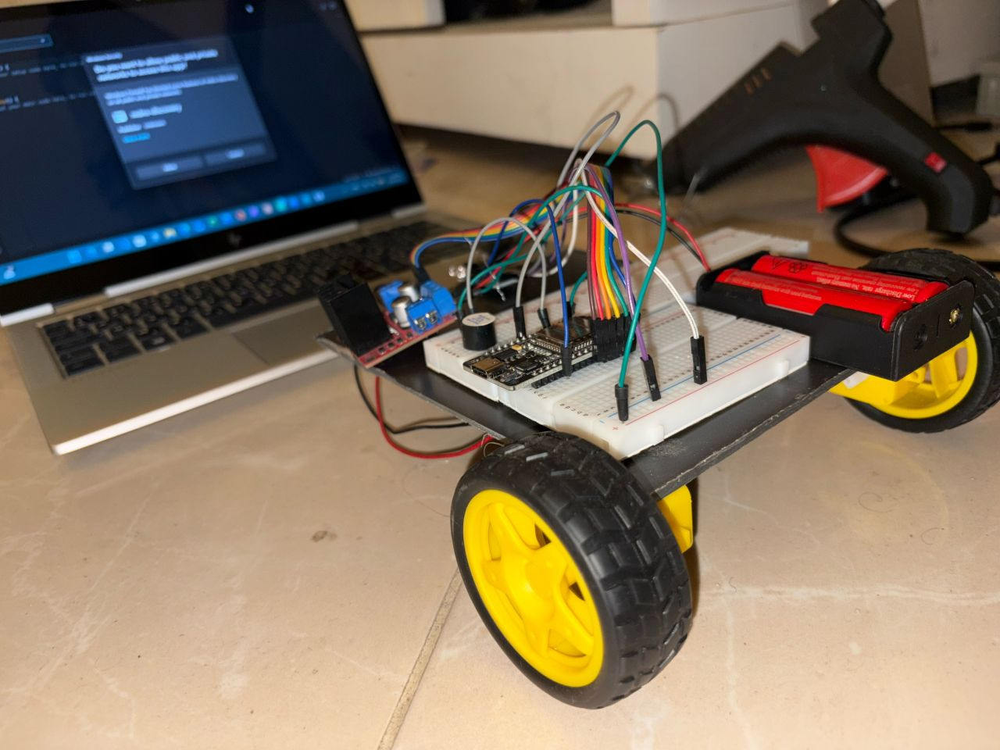
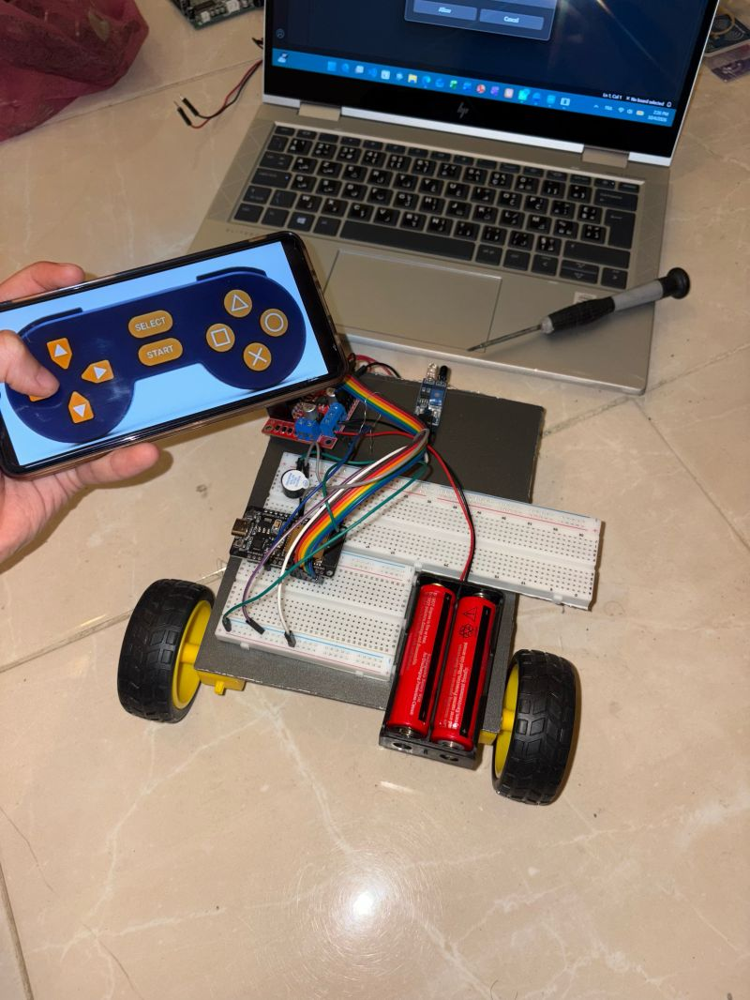

# 🚗 ESP32 Wi-Fi RC Car & Collision-Avoidance System

  
  
  
  
  

## 📌 Overview
A wireless mobile robot controlled via a smartphone or PC browser using an **ESP32 configured as a standalone Wi-Fi Access Point**. The microcontroller hosts an embedded responsive web gamepad (`HTML/CSS/JS`) to drive dual DC motors via an **L298N H-Bridge driver** with PWM speed regulation, while an **Infrared (IR) obstacle sensor** ensures active collision prevention with an emergency stop and acoustic buzzer alert.

---

## ✨ Key Features
- **Standalone Wi-Fi Access Point (`WiFi.softAP`):** No external router required; connect directly to the ESP32 network (`SSID: Rais`).
- **Embedded Web Gamepad:** Responsive touch & mouse control interface (`Forward`, `Backward`, `Left`, `Right`, `STOP`) served on port `80` using asynchronous `fetch()` HTTP requests (`/move?dir=...`).
- **PWM Motor Control:** Smooth speed modulation via `ENA`/`ENB` channels on an L298N motor driver (`PWM 200` straight, `PWM 180` turning).
- **Active Obstacle Avoidance:** Real-time polling of the front IR sensor (`GPIO 34`) that automatically halts the motors and triggers a warning buzzer (`GPIO 32`) upon obstacle detection.

---

## 🔌 Hardware Pinout & Wiring

| Component | Pin Label | ESP32 GPIO | Function |
| :--- | :---: | :---: | :--- |
| **Left Motor (L298N)** | `ENA` | `GPIO 13` | PWM Speed Control |
| **Left Motor (L298N)** | `IN1` / `IN2` | `GPIO 12` / `GPIO 14` | Direction Control |
| **Right Motor (L298N)** | `ENB` | `GPIO 25` | PWM Speed Control |
| **Right Motor (L298N)** | `IN3` / `IN4` | `GPIO 27` / `GPIO 26` | Direction Control |
| **IR Obstacle Sensor** | `OUT` | `GPIO 34` | Digital Obstacle Detection (`LOW` = Obstacle) |
| **Active Buzzer** | `+` | `GPIO 32` | Acoustic Collision Warning |

---

## 📸 Hardware Prototype

  
  &nbsp;&nbsp;
  

---

## 🚀 How to Run
1. Open `receiver_car.ino` in **Arduino IDE** (with the **ESP32 Board Package** installed).
2. Wire the ESP32, L298N driver, DC motors, IR sensor, and buzzer according to the pinout table above.
3. Upload the firmware to the ESP32.
4. On your smartphone or laptop, connect to the Wi-Fi network **`Rais`** (Password: `20262027`).
5. Open a web browser and navigate to **`http://192.168.4.1`** to access the virtual gamepad.

---

## 👩‍💻 Author
**Salsabil Rais** — Embedded Systems & IoT Student (FST Tangier)  

